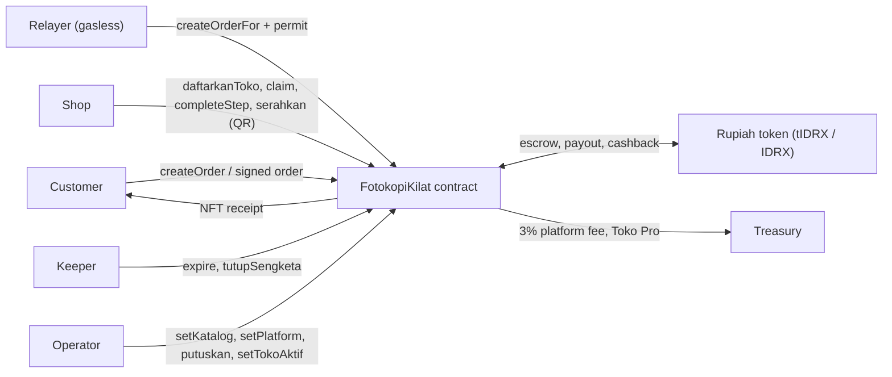
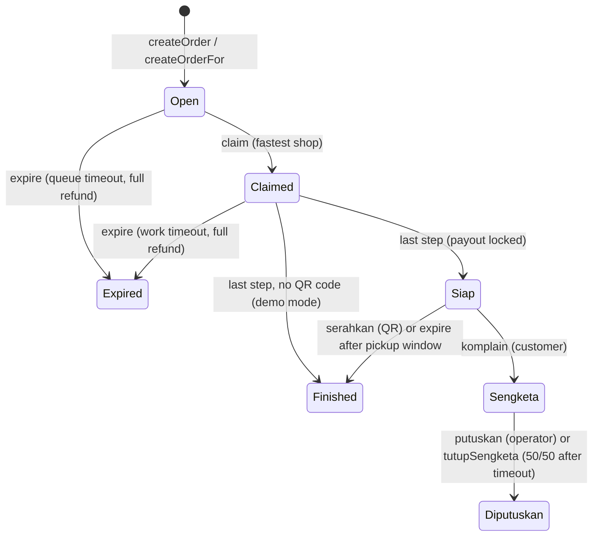

# PrintPitt · contracts

**PrintPitt is GameFi for real print shops.** A customer posts a print job and pays into escrow in a Rupiah token. Shops within 1.5 km race to claim it. The payout decays every second until the shop marks the job ready; the late portion goes back to the customer as cashback. Funds release when the shop scans the customer's QR, and the customer receives an NFT receipt.

## For judges: check it in 5 minutes (no setup)

1. **Try the app:** open https://printpitt-app.vercel.app on your phone, log in, and enter the judge code shown at our pitch. You get free MON for gas and a Rp20.000 voucher, and you pay nothing. Order a print job as a customer, or register a shop and claim orders.
2. **See a real order on Monad mainnet:**
   - order sent gaslessly by the relayer: https://monadscan.com/tx/0x808d0f280a00927f47477163814870fc7776dbf71d0c835cc4476ef93f19f9ef
   - the customer's NFT receipt: https://monadscan.com/token/0x4b453b395eEa830C5CB208551A0326f6cd976f12?a=1
3. **Read the verified source:** https://monadscan.com/address/0x4b453b395eEa830C5CB208551A0326f6cd976f12#code
   - On the **Read Contract** tab, try `getOrder(1)` (a finished real order), `hargaUntuk(5, 10)` (price for a 10-page print), `jumlahToko()` and `platformFeeBps()`.
4. **Run the tests yourself (optional, ~1 min):** `git clone --recurse-submodules https://github.com/PrintPitt/contracts && cd contracts && forge test`. Expect 43 tests + 4 invariants to pass.

## Conceptual diagram



## Order lifecycle



## Glossary (Indonesian identifiers)

| Identifier | Meaning |
|---|---|
| `pelanggan` / `toko` | customer / shop |
| `daftarkanToko`, `ubahNamaToko`, `setTokoAktif` | shop self-registers, renames, operator suspends |
| `serahkan(id, rahasia)` | handover: shop scans the customer's QR secret |
| `komplain`, `putuskan`, `tutupSengketa` | dispute, operator decision, auto-close 50/50 |
| `Siap`, `Sengketa`, `Diputuskan` | ready, disputed, resolved |
| `harga`, `halaman`, `hargaUntuk`, `batasKerja` | price, pages, price quote, work time limit |
| `langgananPro`, `isPro` | Toko Pro subscription |
| `Pesanan`, `Izin` | signed order (EIP-712), token permit |

## Deployments (all verified on Monadscan + Sourcify)

| Network | FotokopiKilat | Token |
|---|---|---|
| Monad mainnet 143 (active) | [0x4b453b39…6f12](https://monadscan.com/address/0x4b453b395eEa830C5CB208551A0326f6cd976f12#code) | tIDRX [0xEf3369C0…c205](https://monadscan.com/address/0xEf3369C083B137C0FB3Fa9424990726d424ac205#code) |
| Monad mainnet 143 (real IDRX) | [0x1F8061d6…5f77](https://monadscan.com/address/0x1F8061d653896fF48EbFDD3Fee7C0684E2995f77#code) | IDRX `0x18Bc5bcC660cf2B9cE3cd51a404aFe1a0cBD3C22` |
| Monad testnet 10143 | [0x24b045E3…5101](https://testnet.monadscan.com/address/0x24b045E3B4155232F81c709dF3DD43595a5C5101#code) | tIDRX [0xcCf26C3b…7F45](https://testnet.monadscan.com/address/0xcCf26C3b02a610fB87327f41a13384aF8ff57F45#code) |

## Payout, cashback and fees

Prices use the token's 2 decimals (Rp1 = 100 units). Let `T` = work time limit (`batasKerja`) and `k` = seconds from claim until the job is ready.

```
payout   = harga × (T − k) / T          (0 when k ≥ T)
fee      = payout × platformFeeBps / 10000   → treasury
shop     = payout − fee
cashback = harga − payout                → customer
```

Example: KTP copy Rp5.000, `T` = 30 s, the shop is ready after 10 s:
- payout = Rp3.333
- platform fee 3% = Rp100, so the shop receives Rp3.233
- the customer gets Rp1.667 back

Unclaimed or late jobs refund 100%, and no fee is charged on them.

## Function reference

| Function | Who | What it does |
|---|---|---|
| `setKatalog(jenis, hargaDasar, hargaPerHalaman, batasDasar, batasPerHalaman, langkah[], label)` | operator | service type; price and time = base + per page × pages (max 500 pages) |
| `setFeeRelay(fee)` · `setPlatform(feeBps, treasury, hargaPro)` | operator | relayer service fee; platform fee (max 10%), treasury, Toko Pro price |
| `registerShop(addr, nama)` · `setTokoAktif(addr, aktif)` | operator | seed a shop; suspend or restore a shop |
| `startSession()` · `endSession()` | operator | open or close an ordering session (leaderboard per session) |
| `daftarkanToko(nama)` · `ubahNamaToko(nama)` | any shop | self-register (no cap) · rename |
| `createOrder(jenis, teks, halaman, dokumen, kodeHash)` | customer | pay into escrow (needs `approve`). `dokumen` = encrypted-file hash; `kodeHash` = keccak256 of the QR secret (0 = demo mode) |
| `createOrderFor(Pesanan, sig, Izin)` | relayer | gasless order: verifies the customer's EIP-712 signature, uses `permit`, pays `feeRelay` to the relayer |
| `claim(id)` | registered, active shop | first shop wins; one active order per shop |
| `completeStep(id, kode)` | winning shop | recipe steps (1 copy, 2 print, 3 laminate). The last step locks the payout (`Siap`), or finishes directly in demo mode |
| `serahkan(id, rahasia)` | winning shop | handover: checks `keccak256(rahasia) == kodeHash`, pays out, mints the NFT receipt |
| `komplain(id)` | customer | dispute while `Siap` and before the pickup window ends |
| `putuskan(id, bagianToko)` | operator | resolve a dispute (basis points of the locked payout to the shop); no NFT |
| `expire(id)` | anyone (keeper) | refund `Open`/`Claimed` after timeout; close `Siap` after `batasJemput` (shop still paid) |
| `tutupSengketa(id)` | anyone (keeper) | dispute not resolved after `batasSengketa` → 50/50 |
| `langgananPro(periode)` | shop | Toko Pro, `hargaPro` × periods (30 days each) to the treasury |
| `getOrder`, `hargaUntuk`, `payoutSekarang`, `isPro`, `pemenang`, `jumlahToko`, `domainSeparator` | views | reads for FE, backend and indexer |

**Events:**
- shops: `ShopRegistered`, `ShopRenamed`, `ShopStatusSet`
- orders: `OrderCreated`, `OrderDetail`, `OrderRelayed`, `OrderClaimed`, `StepCompleted`, `OrderReady`, `OrderFinished(…, diserahkan)`, `OrderExpired`
- disputes: `OrderDisputed`, `DisputeResolved(…, otomatis)`
- revenue: `PlatformFeeTaken`, `ProSubscribed`, `PlatformSet`
- setup: `KatalogSet`, `FeeRelaySet`, `SessionStarted`, `SessionEnded`

**Gasless order type (EIP-712, domain `FotokopiKilat` version `2`):**
`Pesanan(address pelanggan,uint8 jenis,string teks,uint16 halaman,bytes32 dokumen,bytes32 kodeHash,uint256 nonce,uint256 deadline,uint256 maxFee)`

## Security and invariants

- **Checks-effects-interactions** plus `ReentrancyGuardTransient`. Payouts are ERC-20 transfers, so a receiver cannot block an order.
- **Signatures:** per-customer nonces, a deadline, and a `maxFee` the relayer cannot exceed. A permit front-run is tolerated (try/catch, then the allowance is checked).
- **Invariant tests (fuzzed):**
  1. contract token balance == sum of open escrow (`Open`, `Claimed`, `Siap`, `Sengketa`)
  2. no token is created or lost (customer + shops + treasury + contract = supply)
  3. at most one active order per shop
  4. NFTs == finished orders
- **Known limits:** the operator is a single key (use a multisig before real money at scale). `pemenang()` loops over all shops and is meant for off-chain views (the indexer provides the leaderboard).

## Quickstart

```bash
git clone --recurse-submodules https://github.com/PrintPitt/contracts.git
forge build && forge test     # 43 tests + invariants; FOUNDRY_PROFILE=deep runs heavy invariants
```

Monad notes: gas is billed on the gas **limit** (see `GAS_LIMIT` in `shared/`); `code_size_limit = 131072` because the contract is ~25 KB; anvil needs `--code-size-limit 131072`.

## Deploy

Use a Foundry keystore (`--account`), never raw keys. Env vars are documented at the top of `script/Deploy.s.sol` (TOKEN, MINTER, TREASURY, HARGA_BAGI, RELAY_FEE, HARGA_PRO, PLATFORM_FEE_BPS, BATAS_*). Then run `node script/export.mjs` to write `shared/` and `../indexer/abis`.

Related repos: [backend](https://github.com/PrintPitt/backend) · [indexer](https://github.com/PrintPitt/indexer) · [frontend](https://github.com/PrintPitt/frontend)
