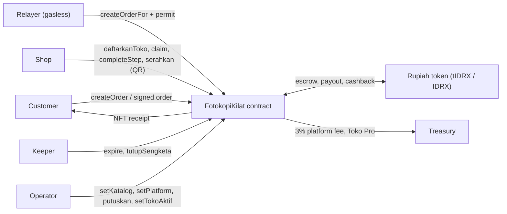
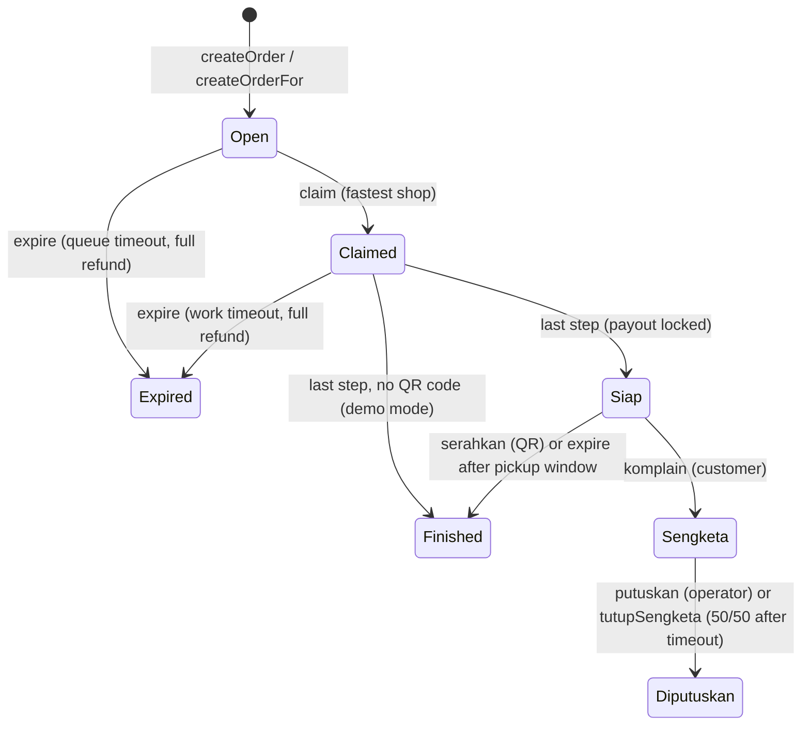

# PrintPitt · contracts

**PrintPitt is GameFi for real print shops.** A customer posts a print job and pays into escrow in a Rupiah token. Shops within 1.5 km race to claim it. The payout decays every second until the shop marks the job ready; the late portion goes back to the customer as cashback. Funds release when the shop scans the customer's QR, and the customer receives an NFT receipt.

## Conceptual diagram



## Order lifecycle



## Glossary (Indonesian identifiers)

| Identifier | Meaning |
|---|---|
| `pelanggan` / `toko` | customer / shop |
| `daftarkanToko`, `ubahNamaToko`, `setTokoAktif` | shop self-registers, renames, operator suspends |
| `serahkan(id, rahasia)` | handover: shop scans the customer's QR secret |
| `komplain`, `putuskan`, `tutupSengketa` | dispute, operator decision, auto-close 50/50 |
| `Siap`, `Sengketa`, `Diputuskan` | ready, disputed, resolved |
| `harga`, `halaman`, `hargaUntuk`, `batasKerja` | price, pages, price quote, work time limit |
| `langgananPro`, `isPro` | Toko Pro subscription |
| `Pesanan`, `Izin` | signed order (EIP-712), token permit |

## Deployments (all verified on Monadscan + Sourcify)

| Network | FotokopiKilat | Token |
|---|---|---|
| Monad mainnet 143 (active) | [0x4b453b39…6f12](https://monadscan.com/address/0x4b453b395eEa830C5CB208551A0326f6cd976f12#code) | tIDRX [0xEf3369C0…c205](https://monadscan.com/address/0xEf3369C083B137C0FB3Fa9424990726d424ac205#code) |
| Monad mainnet 143 (real IDRX) | [0x1F8061d6…5f77](https://monadscan.com/address/0x1F8061d653896fF48EbFDD3Fee7C0684E2995f77#code) | IDRX `0x18Bc5bcC660cf2B9cE3cd51a404aFe1a0cBD3C22` |
| Monad testnet 10143 | [0x24b045E3…5101](https://testnet.monadscan.com/address/0x24b045E3B4155232F81c709dF3DD43595a5C5101#code) | tIDRX [0xcCf26C3b…7F45](https://testnet.monadscan.com/address/0xcCf26C3b02a610fB87327f41a13384aF8ff57F45#code) |

## Quickstart

```bash
git clone --recurse-submodules https://github.com/PrintPitt/contracts.git
forge build && forge test     # 43 tests + invariants; FOUNDRY_PROFILE=deep runs heavy invariants
```

Monad notes: gas is billed on the gas **limit** (see `GAS_LIMIT` in `shared/`); `code_size_limit = 131072` because the contract is ~25 KB; anvil needs `--code-size-limit 131072`.

## Deploy

Use a Foundry keystore (`--account`), never raw keys. Env vars are documented at the top of `script/Deploy.s.sol` (TOKEN, MINTER, TREASURY, HARGA_BAGI, RELAY_FEE, HARGA_PRO, PLATFORM_FEE_BPS, BATAS_*). Then run `node script/export.mjs` to write `shared/` and `../indexer/abis`.

Related repos: [backend](https://github.com/PrintPitt/backend) · [indexer](https://github.com/PrintPitt/indexer) · [frontend](https://github.com/PrintPitt/frontend) · [vault](https://github.com/PrintPitt/vault)

---

# PrintPitt · contracts

Contract `FotokopiKilat` (order escrow, rebutan claim, payout turun per detik, refund, NFT struk) dan token simulasi
Rupiah `TestIDRX` (tIDRX, 2 desimal, `permit`) untuk Monad testnet. Foundry 1.8.6, solc 0.8.31, OpenZeppelin 5.7.0.
Dokumentasi: repo `PrintPitt/vault` → `04-Architecture/Desain Contract.md`.

## Struktur

| Folder | Isi |
|---|---|
| `src/` | `FotokopiKilat.sol`, `TestIDRX.sol` |
| `test/` | unit test + invariant |
| `script/` | `Deploy.s.sol`, `export.mjs` (ABI + alamat → `shared/`, ABI → `../indexer/abis`) |
| `shared/` | package `@printpitt/shared`: ABI, alamat deploy, helper (`teksValid`, `hitungPayout`, `formatRupiah`, tipe EIP-712, `GAS_LIMIT`) |
| `deployments/` | alamat per chain (ditulis script deploy) |

## Mulai

```bash
git clone --recurse-submodules https://github.com/PrintPitt/contracts.git
forge build
forge test                       # invariant penuh: FOUNDRY_PROFILE=deep (CPU berat)
npm --prefix shared install
```

## Deploy (Monad testnet, chain 10143)

Private key tidak pernah ditulis ke file: pakai keystore Foundry.

```bash
cast wallet new ~/.foundry/keystores deployer
TOKO_A=0x… TOKO_B=0x… MINTER=0x… forge script script/Deploy.s.sol \
  --rpc-url $MONAD_RPC_URL --account deployer --broadcast
node script/export.mjs           # tulis shared/src/*.generated.ts, build shared, salin ABI ke ../indexer/abis
```

Env opsional: `NAMA_TOKO_A`, `NAMA_TOKO_B`, `RELAY_FEE` (default 10000 = Rp100), `NFT_NAME`, `NFT_SYMBOL`,
`BATAS_ANTRE` (45), `START_SESSION` (true).

## Memakai `@printpitt/shared`

Selama repo private, backend dan frontend memasang package ini sebagai tarball (`npm run pack:vendor` di `shared/`,
atau `scripts/sync-shared.sh` di repo backend). Setelah repo publik bisa langsung dari git.
